# Enthalpia

**A desktop process simulator for chemical engineering: steady-state and dynamic simulation, free to use.**

[-1a7431?style=for-the-badge&logo=windows)](../../releases/latest/download/Enthalpia-3.0-Setup.exe)
[-1a7431?style=for-the-badge&logo=apple)](../../releases/latest/download/Enthalpia-2.1-macOS-arm64.dmg)

How to install is described [further down](#download-and-install).

Version 3.0 for Windows; version 2.1 for macOS. Copyright (c) 2026 Leonidas Manikis. All rights reserved.

[](https://revolut.me/l_manikis)

*Every donor is named and thanked in the finished program and its guide.*

Enthalpia lets you choose components and a property package, draw a flowsheet of unit operations joined by
material streams, enter the feeds and the specifications, and see every stream and every duty calculated from
the mass and energy balances with rigorous phase equilibrium. It is written for students and for engineers who
want a first answer quickly and want to see how it was reached.

[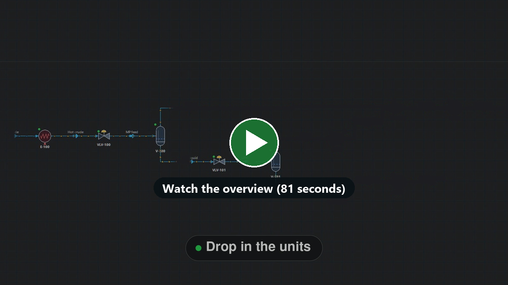](video/enthalpia_overview.mp4)

*Click the picture to watch the 81-second overview.*

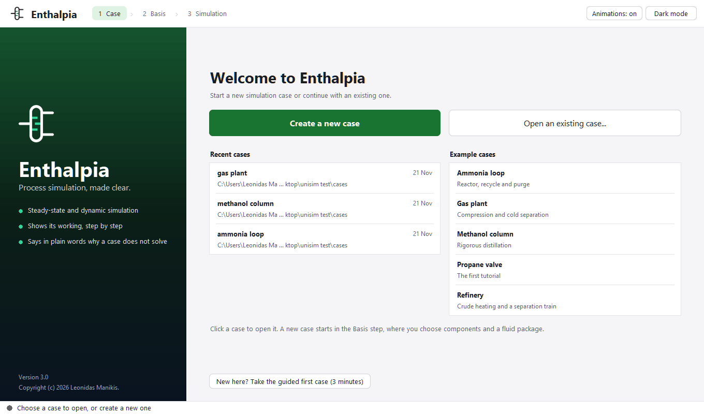

*The opening page: start a new case, continue a recent one, or open an example*


*The flowsheet: units from the palette on the left, results in the workbook below*

## New in version 3.0

- **Checked against data.** 224 results of the program are set beside published values, measured mixtures
  included, and the whole table is [in this repository](VALIDATION.md). Water in the equation-of-state packages,
  gases with water, heat capacities of hot gases and liquids were corrected on the way.
- **A guided first case.** A small window takes a newcomer through a first simulation in nine steps.
- **Find anything (Ctrl+K).** A few letters find any command, tool, unit or stream.
- **Exchanger rating.** A shell-and-tube bundle set against the duty: film coefficients, overall coefficient,
  margin and pressure drops.
- **Gas checks.** Water content, water and hydrocarbon dew points and the hydrate temperature of every gas stream.
- **The flowsheet as a drawing.** PNG or PDF, with the stream table underneath.
- **Everyday things.** Paste a composition from a spreadsheet, case files of their own kind (`.enth`) that open
  with a double-click, a check for new versions, a file to send when something goes wrong, and an installer that
  is one file.

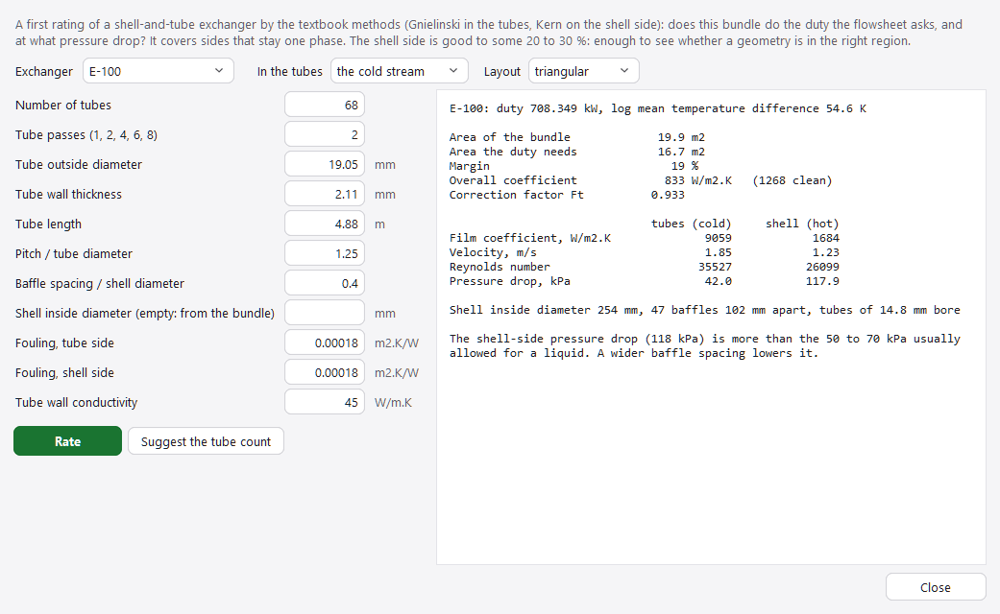

*Exchanger rating: the bundle on the left, what it does on the right*

## How it works, in pictures

### 1. Choose the components and the property package

Pick from more than 6,000 components (over 70,000 can be found by name or CAS number) and one of 24 property
packages: cubic equations of state, activity-coefficient models, reference equations for pure fluids, steam tables.
The program says which packages suit the mixture and what data is missing.

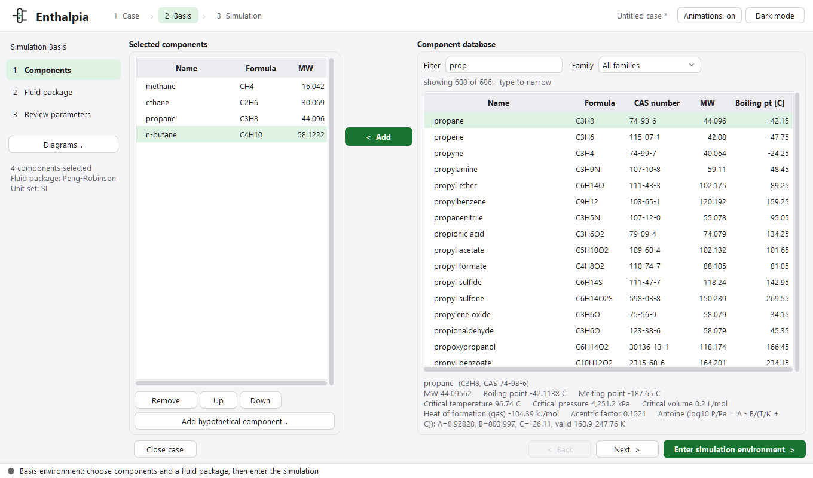

*Choosing components*


*Choosing the property package*

### 2. Draw the flowsheet and enter the data

27 unit operations: mixers, splitters, valves, pumps, compressors, expanders, heaters, coolers, heat exchangers,
pipes, tanks, separators, shortcut and rigorous distillation, absorbers, five kinds of reactor, recycle, adjust,
set, spreadsheet and script blocks. Every edit is solved at once; undo and redo cover the last hundred changes.


*A stream: any two of temperature, pressure and vapour fraction, the flow and the composition*

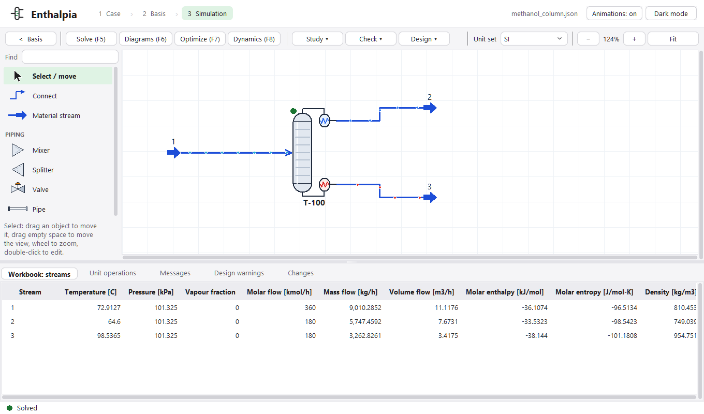

*A methanol and water distillation column*


*A larger case: crude stabilisation and gas recovery*

### 3. Read the results, and see how they were reached


*Show the working: the calculation of a unit, step by step, with its numbers*

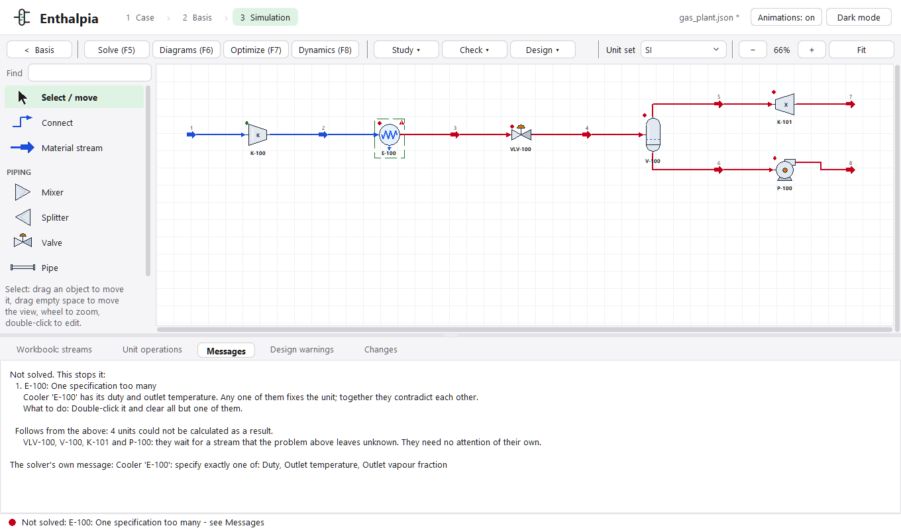

*When a case does not solve, the program names the input that stops it and what to do*


*Design warnings an engineer would raise, each with its numbers*

### 4. Diagrams


*Phase envelope of a stream*

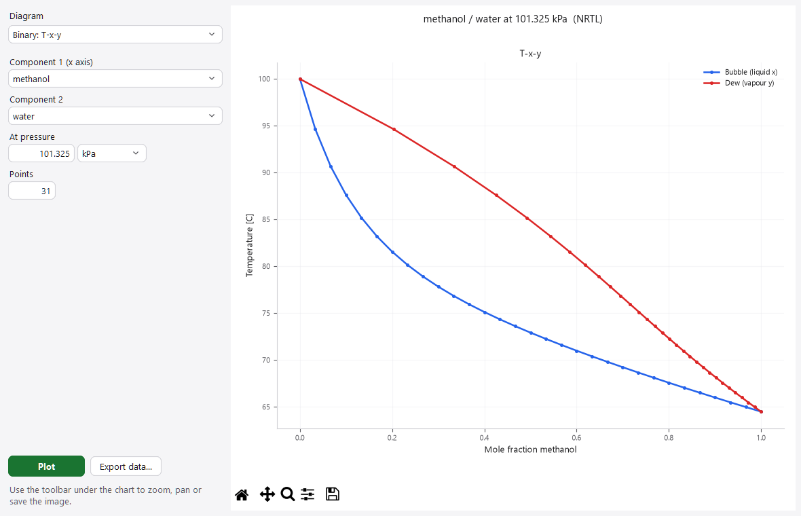

*T-x-y diagram of a binary mixture*

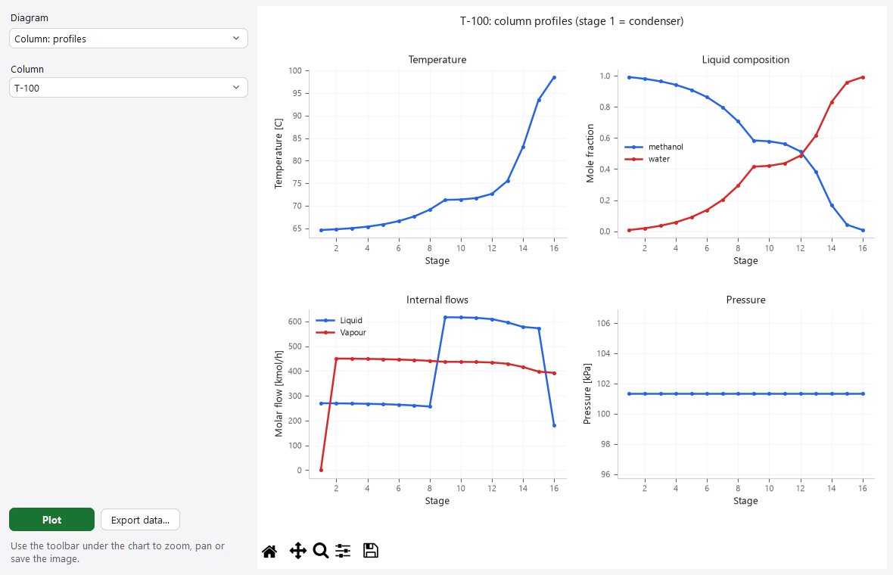

*Temperature and composition profiles of a column*

### 5. Study the process


*Case study: one input varied, any results recorded and plotted*

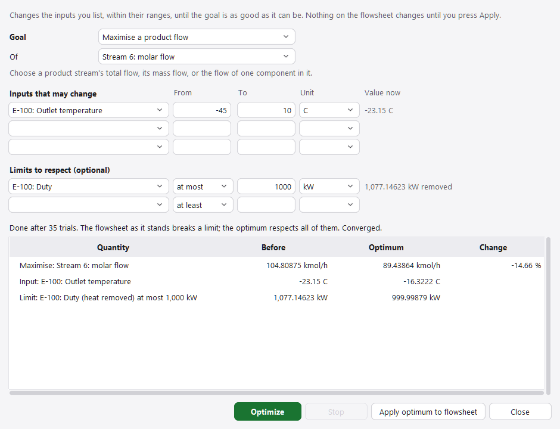

*Optimizer: several inputs, a goal and limits*


*Scenarios: named sets of inputs solved and compared side by side*

### 6. Dynamic simulation

Tanks, separators and stirred reactors hold material; level, pressure and temperature controllers act on valves
and duties; events disturb the feed.


*A separator under pressure and level control after a step in the feed*

### 7. From a simulation to a first design

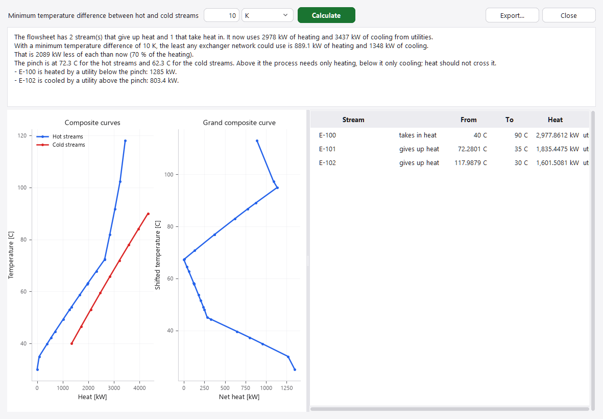

*Pinch analysis: heating and cooling targets*

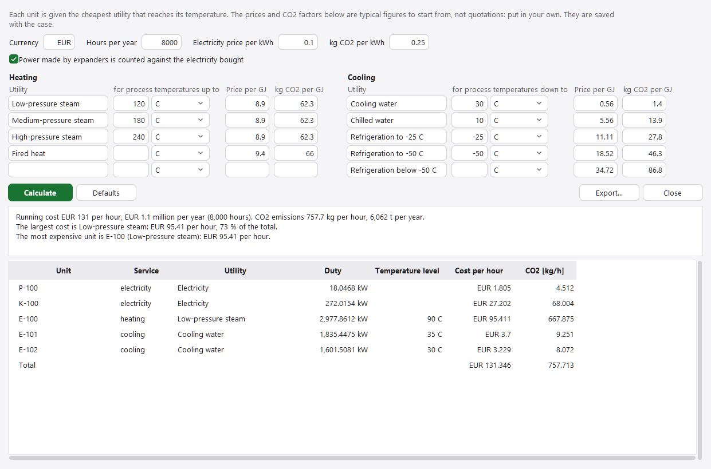

*Utilities, running cost and CO2*


*First sizes of vessels, columns, exchangers, lines and relief valves*

Reports go to Excel and Word. Light and dark mode, any unit set, and a recovery copy of unsaved work.

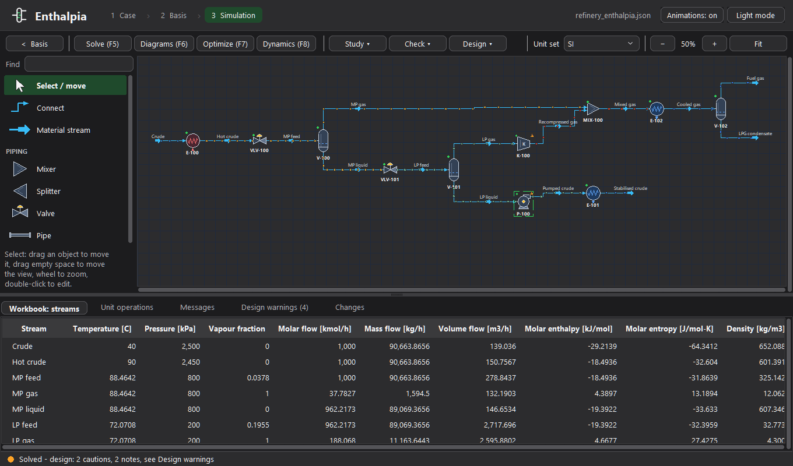

*Dark mode*

The guide, with seven tutorials and the validation of the program against reference data, is in this
repository: [Enthalpia-Documentation.pdf](Enthalpia-Documentation.pdf). The same guide opens from the Help menu.

## Can the results be trusted?

Check for yourself: **[VALIDATION.md](VALIDATION.md)** sets 224 results of Enthalpia beside values that do not
come from a simulator: the reference equations of state of the pure fluids, the GERG-2008 equation for natural
gas, the international steam tables, azeotropes from the handbooks, and hand calculations. Nothing is left out
of that table, including the cases where the program is weakest.

| | Checks | Average difference | Largest |
|---|---:|---:|---:|
| Pure fluids at their boiling point (Peng-Robinson) | 25 | 0.4 % | 1.7 % |
| Water and steam (Steam IAPWS-95 package) | 6 | 0.0 % | 0.0 % |
| Gas density at pressure (Peng-Robinson and tc-PR) | 14 | 2.1 % | 4.9 % |
| Unit operations | 12 | 0.6 % | 1.0 % |
| Mixtures: azeotropes at 1 atm (activity models) | 10 | in degrees | in degrees |
| Viscosity and thermal conductivity (Peng-Robinson) | 18 | 0.9 % | 2.9 % |
| Gases at high temperature (Peng-Robinson) | 26 | 0.1 % | 0.7 % |
| Heating a liquid | 30 | 3.7 % | 35.9 % |
| Reactions, combustion and heat integration | 7 | 0.1 % | 0.5 % |
| Mixtures of light hydrocarbons and gases: bubble and dew pressure (Peng-Robinson) | 20 | 1.3 % | 6.2 % |
| Polar liquids boiling under pressure (NRTL-PR) | 20 | 1.7 % | 5.6 % |
| Mixtures: measured boiling of binary liquids at 1 atm (NRTL and UNIFAC) | 36 | in degrees | in degrees |

Temperatures there (boiling points, valve outlets, azeotropes) are compared in degrees and listed line by line.
The same checks run in the program's test suite before every release.

## Download and install

1. Go to **[Releases](../../releases/latest)** and download `Enthalpia-3.0-Setup.exe` (342 MB). It is one file; there is nothing to unpack.
2. Double-click it. A small picture shows for a few seconds while it prepares; then follow the steps.
   No administrator rights are needed.
3. Start Enthalpia from the Desktop or the Start menu.

Windows may say that the program comes from an unknown publisher, because the installer does not yet carry a
paid code-signing certificate. Choose **More info**, then **Run anyway**. To be sure that the file you downloaded
is the one published here, compare its SHA-256 fingerprint with this one:

```
f7769187a5c65abad218633940970ef9d5704be432d68f8fdfe8db214bd984f7  Enthalpia-3.0-Setup.exe
```

In PowerShell: `Get-FileHash Enthalpia-3.0-Setup.exe -Algorithm SHA256`

**Needs:** Windows 10 or 11, 64-bit, about 1 GB of disk space. Nothing else has to be installed.
To remove it: Settings > Apps > Enthalpia > Uninstall.

### macOS (Apple silicon)

**The macOS download is still version 2.1.** Version 3.0 for the Mac follows; what is new in it is on Windows only until then.

1. From **[Releases](../../releases/latest)** download `Enthalpia-2.1-macOS-arm64.dmg` (135 MB).
2. Open it and drag Enthalpia into the Applications folder.
3. The first time, macOS refuses to open it, because the application is not signed with a paid Apple developer
   certificate. Open **System Settings > Privacy & Security**, scroll down to the message about Enthalpia and
   choose **Open Anyway**. After that it starts like any other application.

```
fafd08c9b0ba546d34bf6043b125377529cdaed0cc023685fcc0e142afb0cea7  Enthalpia-2.1-macOS-arm64.dmg
```

In Terminal: `shasum -a 256 Enthalpia-2.1-macOS-arm64.dmg`

**Needs:** a Mac with an Apple processor (M1 or later). The macOS version passes the same automatic tests as the
Windows version and has been tried by hand on a Mac. It has had less use than the Windows version, so please
report what does not work.

## Licence

Enthalpia is the work of **Leonidas Manikis**, who holds the copyright in the program, its documentation, its example
cases, its name and its logo.

- You may **use** this version free of charge, on any number of computers, for private, educational, academic and
  commercial work. What you make with it is yours.
- You may **pass on** the original installer, complete and unchanged, free of charge and with its licence.
- You may **not** present Enthalpia or any part of it as your own work, remove or change its notices, change it,
  take it or parts of it into other software, sell it, or offer it for download elsewhere.

The full terms are in [LICENSE.txt](LICENSE.txt). The open-source components inside Enthalpia keep their own
licences: [THIRD-PARTY-LICENSES.txt](THIRD-PARTY-LICENSES.txt).

The program's source code is not published.

## Please read before you rely on a result

Enthalpia calculates with models and data that have limits, and it can be wrong. Its results are an aid to an
engineer's judgement, not a substitute for it. Before a result is used for design, safety, operation or
purchasing, a qualified engineer must check it by independent means. The program comes without warranty of any
kind; see the licence.

## Support the project

Enthalpia is free, and it stays free to use. It is written and maintained by one person in his own time. If it
is useful to you and you would like to help it grow (more unit operations, more property data, a signed
installer that Windows and macOS accept without a warning), you can send a donation of any size:

**[Donate through Revolut](https://revolut.me/l_manikis)** (by card, no Revolut account needed)

Every donation is acknowledged: everyone who donates will be named and thanked in the finished program and in its
guide. If you would rather not be named, say so in the note of your payment and you will be thanked without your
name.

A donation is a gift: it buys no licence, no support contract and no say over the program. Reporting what does
not work, and telling others about Enthalpia, helps just as much.

## Problems and questions

Use the **Issues** tab of this repository. In the program, **Help > Report a problem** saves one file with
everything needed to look into it (what you wrote, the program version, the messages, and the open case if you
leave that box ticked; your user name and folder names are taken out). Nothing is sent by the program: attach the
file to your issue. A result that disagrees with a measured or published value is as welcome as a fault.
