# Enthalpia

**A desktop process simulator for chemical engineering: steady-state and dynamic simulation, free to use.**

Version 1.3 for Windows. Copyright (c) 2026 Leonidas Manikis. All rights reserved.

Enthalpia lets you choose components and a property package, draw a flowsheet of unit operations joined by
material streams, enter the feeds and the specifications, and see every stream and every duty calculated from
the mass and energy balances with rigorous phase equilibrium. It is written for students and for engineers who
want a first answer quickly and want to see how it was reached.

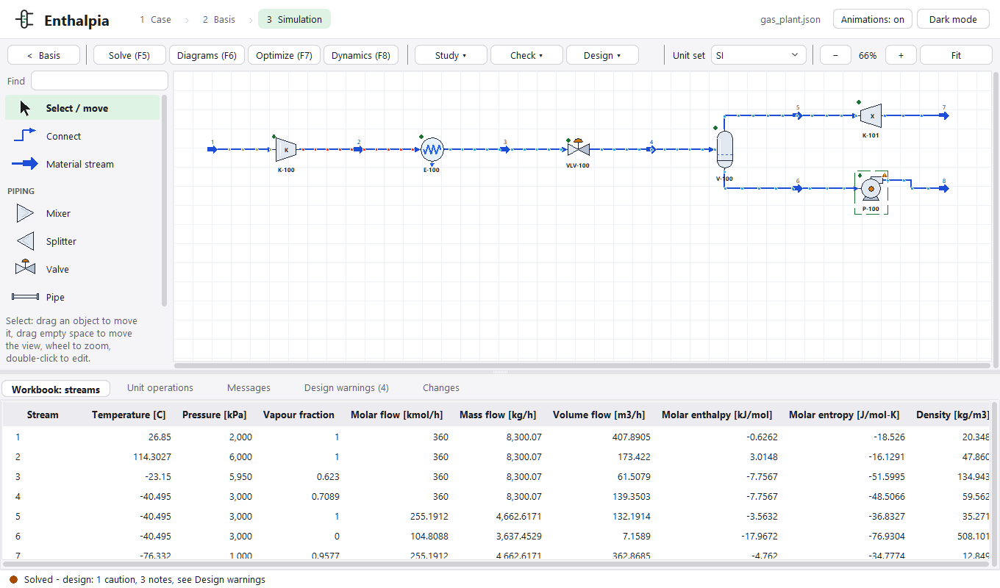

*The flowsheet: units from the palette on the left, results in the workbook below*

## How it works, in pictures

### 1. Choose the components and the property package

Pick from more than 6,000 components (over 70,000 can be found by name or CAS number) and one of 23 property
packages: cubic equations of state, activity-coefficient models, reference equations for pure fluids, steam tables.
The program says which packages suit the mixture and what data is missing.


*Choosing components*

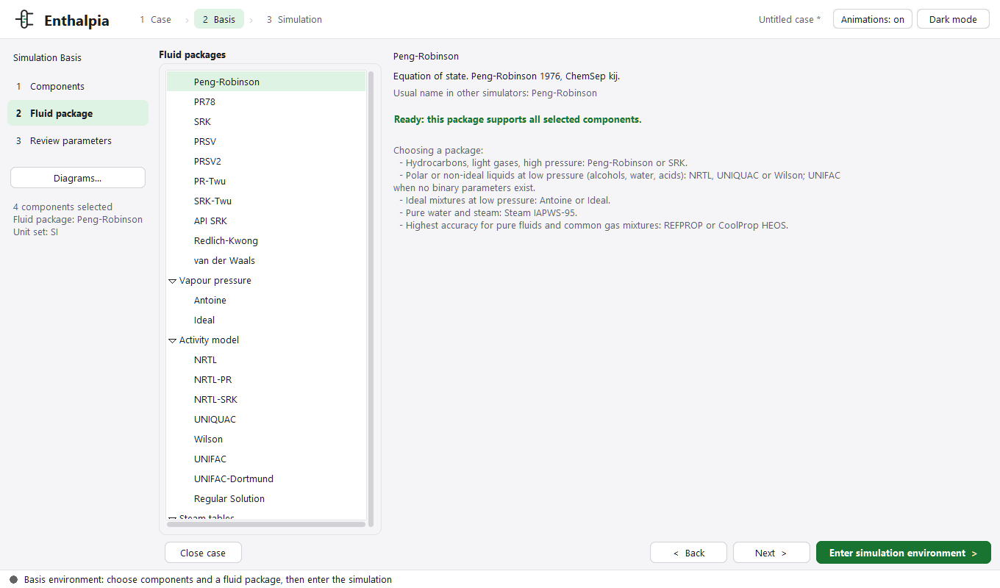

*Choosing the property package*

### 2. Draw the flowsheet and enter the data

27 unit operations: mixers, splitters, valves, pumps, compressors, expanders, heaters, coolers, heat exchangers,
pipes, tanks, separators, shortcut and rigorous distillation, absorbers, five kinds of reactor, recycle, adjust,
set, spreadsheet and script blocks. Every edit is solved at once; undo and redo cover the last hundred changes.

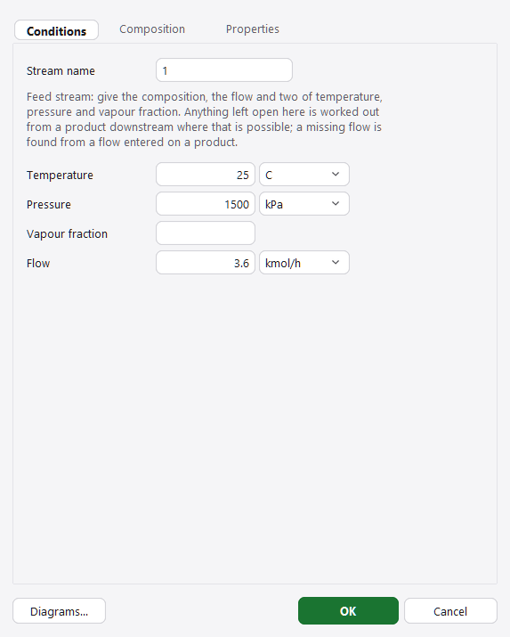

*A stream: any two of temperature, pressure and vapour fraction, the flow and the composition*


*A methanol and water distillation column*

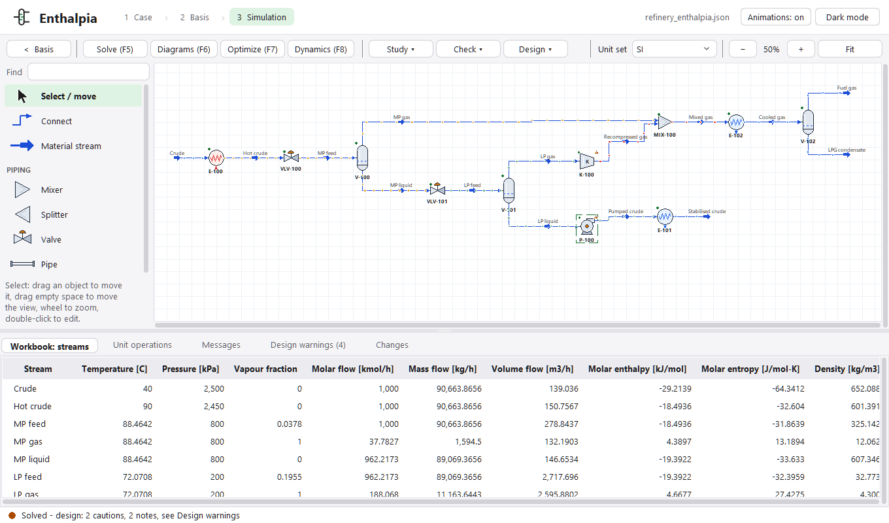

*A larger case: crude stabilisation and gas recovery*

### 3. Read the results, and see how they were reached

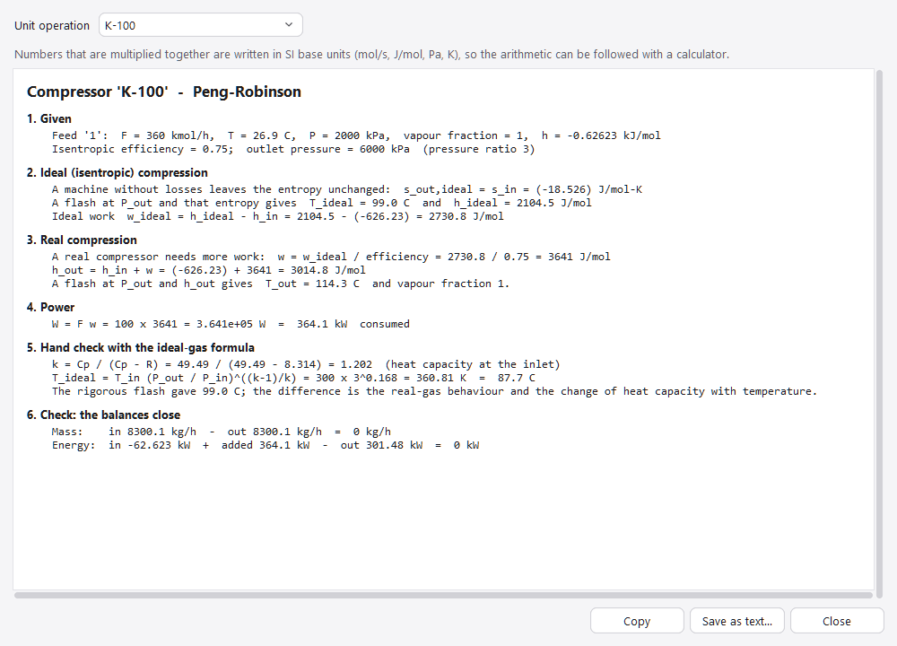

*Show the working: the calculation of a unit, step by step, with its numbers*


*When a case does not solve, the program names the input that stops it and what to do*

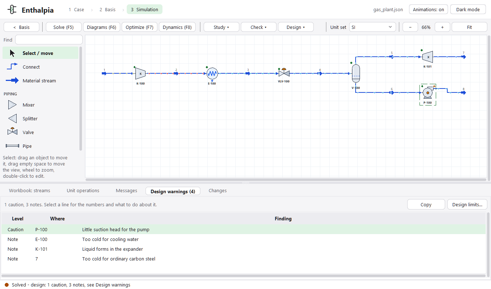

*Design warnings an engineer would raise, each with its numbers*

### 4. Diagrams

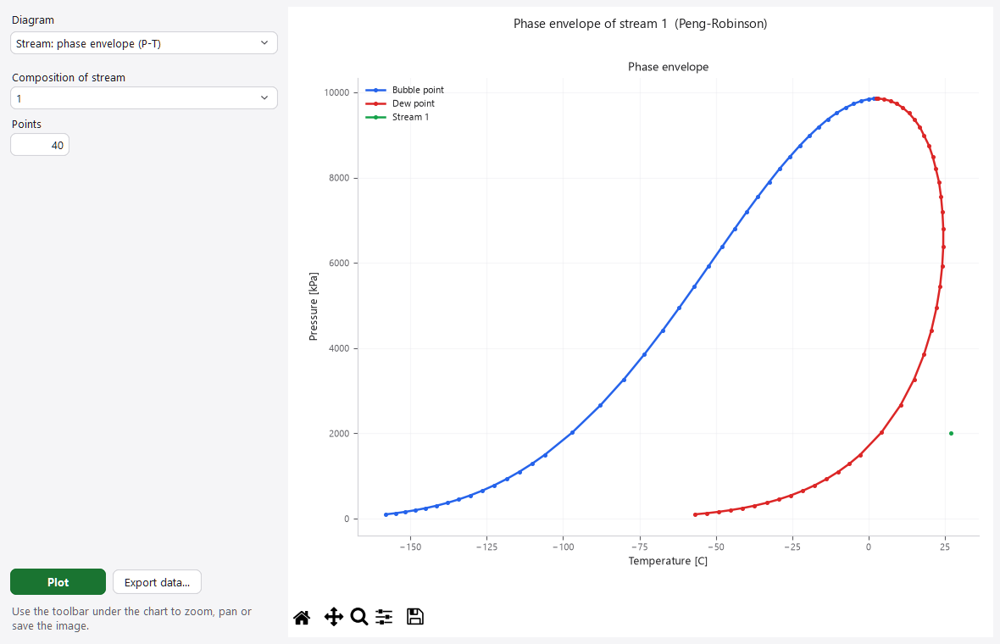

*Phase envelope of a stream*


*T-x-y diagram of a binary mixture*


*Temperature and composition profiles of a column*

### 5. Study the process

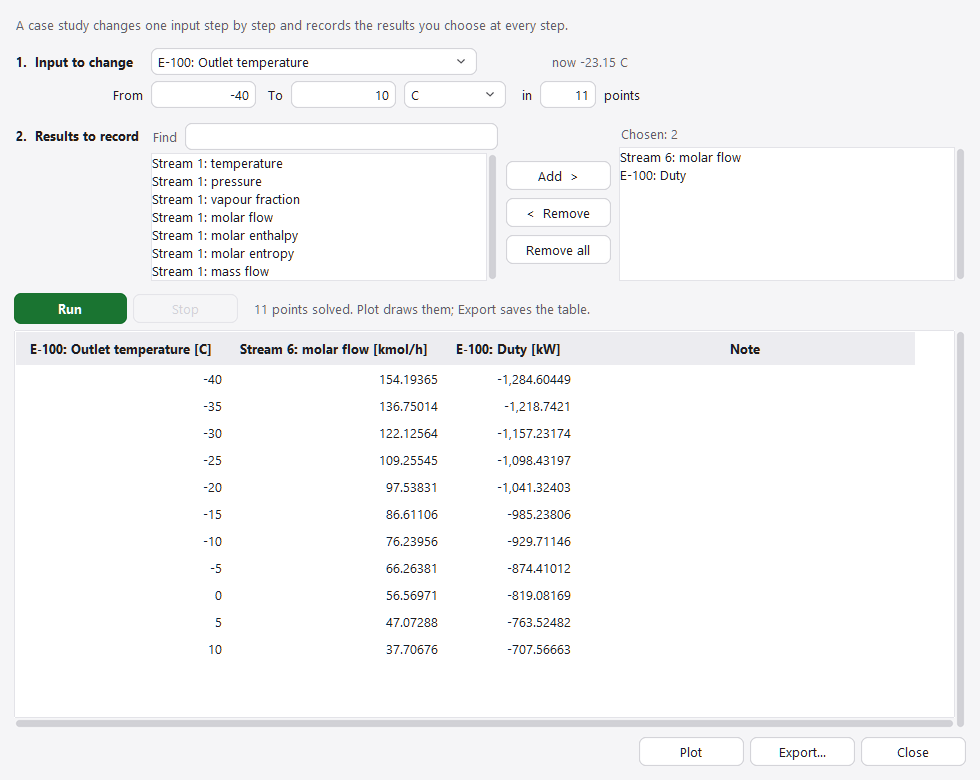

*Case study: one input varied, any results recorded and plotted*


*Optimizer: several inputs, a goal and limits*

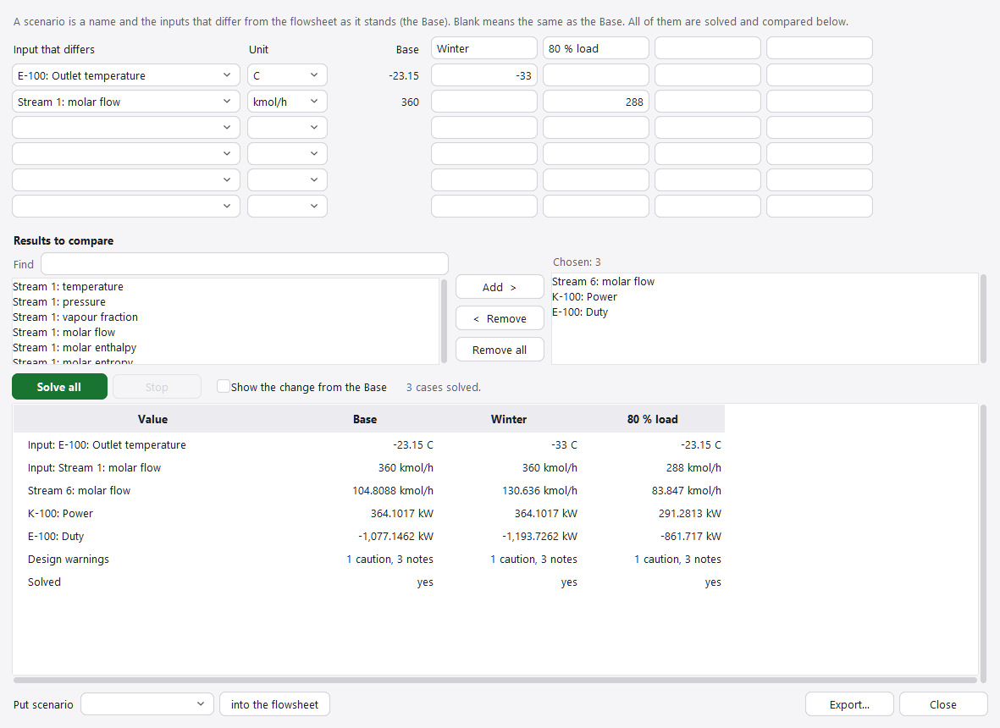

*Scenarios: named sets of inputs solved and compared side by side*

### 6. Dynamic simulation

Tanks, separators and stirred reactors hold material; level, pressure and temperature controllers act on valves
and duties; events disturb the feed.

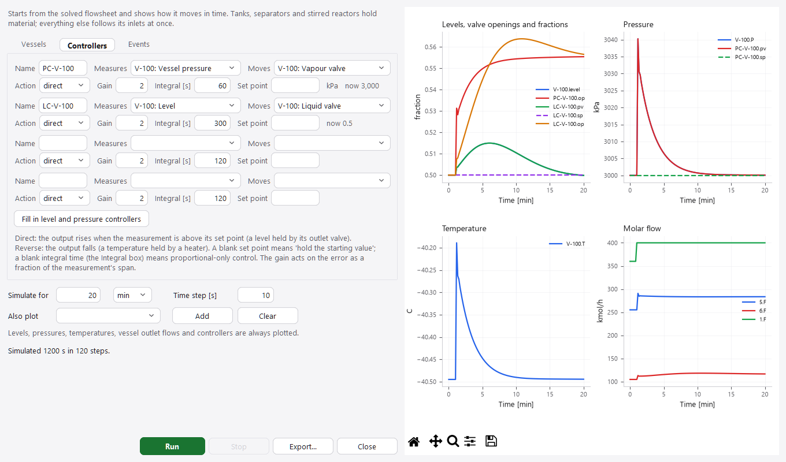

*A separator under pressure and level control after a step in the feed*

### 7. From a simulation to a first design


*Pinch analysis: heating and cooling targets*


*Utilities, running cost and CO2*

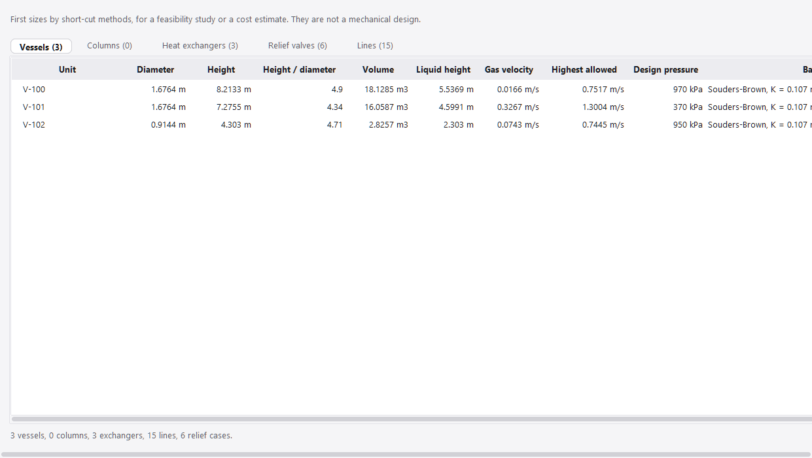

*First sizes of vessels, columns, exchangers, lines and relief valves*

Reports go to Excel and Word. Light and dark mode, any unit set, and a recovery copy of unsaved work.


*Dark mode*

The guide, with seven tutorials and the validation of the program against reference data, is in this
repository: [Enthalpia-Documentation.pdf](Enthalpia-Documentation.pdf). The same guide opens from the Help menu.

## Download and install

1. Go to **[Releases](../../releases/latest)** and download `Enthalpia-1.3-Windows.zip` (337 MB).
2. Unpack the ZIP. Keep `Enthalpia-Setup.exe` and `Enthalpia-payload.zip` together in one folder.
3. Double-click `Enthalpia-Setup.exe` and follow the steps. No administrator rights are needed.
4. Start Enthalpia from the Desktop or the Start menu.

Windows may say that the program comes from an unknown publisher, because the installer does not yet carry a
paid code-signing certificate. Choose **More info**, then **Run anyway**. To be sure that the file you downloaded
is the one published here, compare its SHA-256 fingerprint with this one:

```
9a7f6f5a7d3e3e7507399bae7c5c1a9c74a5e1d79cf82161241f4cd978e1fb67  Enthalpia-1.3-Windows.zip
```

In PowerShell: `Get-FileHash Enthalpia-1.3-Windows.zip -Algorithm SHA256`

**Needs:** Windows 10 or 11, 64-bit, about 1 GB of disk space. Nothing else has to be installed.
To remove it: Settings > Apps > Enthalpia > Uninstall.

## Licence

Enthalpia is the work of **Leonidas Manikis**, who holds the copyright in the program, its documentation, its example
cases, its name and its logo.

- You may **use** this version free of charge, on any number of computers, for private, educational, academic and
  commercial work. What you make with it is yours.
- You may **pass on** the original installer, complete and unchanged, free of charge and with its licence.
- You may **not** present Enthalpia or any part of it as your own work, remove or change its notices, change it,
  take it or parts of it into other software, sell it, or offer it for download elsewhere.

The full terms are in [LICENSE.txt](LICENSE.txt). The open-source components inside Enthalpia keep their own
licences: [THIRD-PARTY-LICENSES.txt](THIRD-PARTY-LICENSES.txt).

The program's source code is not published.

## Please read before you rely on a result

Enthalpia calculates with models and data that have limits, and it can be wrong. Its results are an aid to an
engineer's judgement, not a substitute for it. Before a result is used for design, safety, operation or
purchasing, a qualified engineer must check it by independent means. The program comes without warranty of any
kind; see the licence.

## Problems and questions

Use the **Issues** tab of this repository. If the program reports a fault of its own, the details are in
`error.log` in the folder `.enthalpia` of your user folder; attach that file and say what you did.
